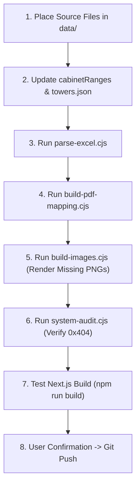

# INTEQC Drawing & Electrical Schematic Onboarding SOP

This skill defines the complete Standard Operating Procedure for onboarding new Towers, Cabinets, and Electrical Schematics into the **INTEQC I/O Finder** system.

---

## 1. System Philosophy & Architecture Rules

### 1.1 Dual Schematic Structure
Industrial electrical drawing packages contain two distinct types of sheets:
1. **PLC I/O Sheets (24V DC)**: Contain 24V DI/DO wiring, field sensor terminals, relay coils, and PLC bit addresses (e.g., `I0.0`, `Q12.4`). These map directly to PLC tag spreadsheets.
2. **Electrical Power & Control Schematics (380V / 220V)**: Contain 3-phase power distribution, circuit breakers, contactors, thermal overloads, soft starters, VFD frequency inverters, power meters, control interlocks, and valve manifolds. **These do NOT contain PLC bit addresses**, but are critical for electricians troubleshooting machines.

The system must map **both** sheet types to machine equipment codes so technicians have instant access to power circuits, starter schematics, and PLC wiring from a single view.

### 1.2 Mandatory Project Constraints
- **English-Only UI**: All equipment names, category labels, badges, and user-facing text must be displayed in **English only**. Chinese text from drawing title blocks must be translated or mapped to English categories before reaching the UI.
- **Extensible Architecture**: New Towers and Cabinets must be easily addable via declarative configuration (`data/towers.json` and `cabinetRanges` in `build-pdf-mapping.cjs`) without rewriting core viewer logic.
- **Zero Broken Links (0 × 404)**: Every schematic pill and drawing dropdown item rendered in the UI must correspond to a verified physical PNG image on disk.
- **Git Push Protection**: **Always obtain explicit user confirmation** before running `git push` to GitHub remotes (`origin` and `backup`).

---

## 2. Source Data Organization

Source files are stored per-location under the `data/` directory:

```text
data/
├── Tower 1/
│   ├── 泰国inteqc Cabinet drawing.pdf
│   └── PLCTags.xlsx
├── Tower 2/
│   ├── Phase 1/
│   │   ├── 泰国inteqc Cabinet drawing.pdf
│   │   └── PLCTags.xlsx
│   └── Phase 2/
│       ├── 泰国inteqc Cabinet drawing.pdf
│       └── PLCTags.xlsx
└── Tower 3/
    ├── INTELQCTower3.pdf
    └── PLCTags.xlsx
```

### Location IDs
- `tower1`: Tower 1
- `tower2_p1`: Tower 2 (Phase 1)
- `tower2_p2`: Tower 2 (Phase 2)
- `tower3`: Tower 3
- Future towers should follow the lowercase naming pattern: `tower4`, `tower5`, etc.

---

## 3. Physical Drawing Structure & Reading Heuristics

### 3.1 Internal Page Number (页数) vs. PDF Page Index
> [!IMPORTANT]
> The PDF viewer page index (1-based physical page in Adobe/PDF reader) does **NOT** equal the drawing sheet's internal page number (`页数`).
> Image files on disk are named by internal page: `<Cabinet>_page_<InternalPageNumber>.png` (e.g., `RCB7_page_173.png`, `CB_page_2.png`).

### 3.2 Reading the Table of Contents (目录)
Most drawings begin with 目录 (Index) pages containing 6 structured columns:
| Column | Header | Description |
|---|---|---|
| 1 | Location | Cabinet ID (e.g., `LCB_6B`, `MCC14`, `RCB7`) |
| 2 | Page | Internal page number (e.g., `173`, `2503`) |
| 3 | Title (CN) | Chinese title / machine description |
| 4 | Title (EN) | English title / description |
| 5 | 日期 (Date) | Creation or revision date |
| 6 | 编辑者 (Editor) | Engineer initials |

### 3.3 Title Block Parsing Patterns

#### A. Chinese Title Blocks (e.g., Tower 2 Phase 1 & Phase 2)
Located in the bottom-right corner of each sheet:
- **True Page Number Extraction (Date-Follower Pattern)**:
  > [!CRITICAL]
  > In EPLAN CAD drawings for Tower 2, the bottom-left margin displays the **previous sheet's cross-reference number** (e.g. `172`, `2110`).
  > In the raw PDF text stream, this margin number appears directly before `魏正彪 审核`. Matching before `魏正彪 审核` creates a systematic **off-by-one (-1) error across all sheets**!
  > Instead, the **true sheet number** is positioned in the `页号 Page` cell immediately following the creation date (`YYYY/M/D` pattern).
  > **Mandatory pattern**: Scan lines for `/^\d{4}\/\d{1,2}\/\d{1,2}$/` and extract the token directly on the next line (e.g. `173`, `174`, `2111`).
  > For cover/overview sheets without a date, use the `格式 A4\s+([0-9a-zA-Z\.\-_]+)` pattern.

- Equipment code is typically followed by the circuit description, for example:
  - `G0104_3 软启动回路图` $\rightarrow$ Equipment: `G0104_3`, Type: Soft Starter Circuit
  - `G0203_3 变频器回路图` $\rightarrow$ Equipment: `G0203_3`, Type: VFD Drive Circuit
  - `1001-2 控制回路` $\rightarrow$ Equipment: `1001-2`, Type: PLC Control Circuit
  - `气动阀 10.02.V` $\rightarrow$ Sub-tag: `10.02.V`, Parent: `10.02`

#### B. English Title Blocks (e.g., Tower 3 Muyang-WEM Format)
Text runs in the bottom border or title line:
- Format pattern: `PAGE TOTAL <TotalPages> ... <DrawingCode> ... 4 <InternalPage> 2` (where `<TotalPages>` is `1000` or `1400`, regex `\b(?:1000|1400)\b[\s\S]{1,30}?\b4\b\s+(\d{3,4})\s+2`)
- Or explicit Chinese page token: `页数 <InternalPage>` (excluding `总页数`)
- Equipment markers: `TOWARDS THE SILO FEEDING G0104_3`, `4_10.V`, `MCC14-01-M1`
- Noise to filter out: Electrical ratings (`5.5KW`, `6.9A`, `380V`, `24VDC`, wire gauges).

---

## 4. Standard 6-Category Schematic Classification

Every identified electrical schematic sheet must be mapped to one of the following standard English categories:

| Category Name | Badge Color | Matching Keywords (CN / EN) | Description |
|---|---|---|---|
| **Power & Metering** | Amber (`#f59e0b`) | `电源回路`, `电表`, `Power`, `Supply`, `Metering`, `Incoming` | 3-phase 380V incoming feeder, metering CTs, busbar distribution |
| **Soft Starter Circuit** | Violet (`#8b5cf6`) | `软起`, `Soft Starter`, `Soft start`, `SST` | Soft starter motor control, bypass contactor, fault feedback |
| **VFD Drive Circuit** | Blue (`#3b82f6`) | `变频器`, `Inverter`, `VFD`, `Frequency` | Frequency drive controller, analog speed reference, run/stop relays |
| **PLC Control Circuit** | Green (`#10b981`) | `控制回路`, `Control Circuit`, `PLC Control`, `Relay` | 24V/220V control interlocking, auxiliary contacts, run permissive |
| **Safety & Interlock** | Rose (`#f43f5e`) | `急停`, `Safety`, `E-Stop`, `Interlock` | Emergency stop circuits, pull-cord switches, safety relays |
| **Valve & Actuator** | Teal (`#14b8a6`) | `气动阀`, `电磁阀`, `Valve`, `Solenoid`, `Pneumatic` | Solenoid manifolds, position switches, damper actuators |

---

## 5. End-to-End Onboarding Protocol (Step-by-Step)



### Step 1: Ingestion & Cabinet Registration
1. Save the drawing PDF to `data/<Tower Name>/INTELQCTower3.pdf` (or `泰国inteqc Cabinet drawing.pdf` for earlier drawings).
2. Save the PLC Tag spreadsheet to `data/<Tower Name>/PLCTags.xlsx`.
3. Open the PDF TOC (or scan first 54 pages) to determine cabinet internal page ranges and physical page boundaries.
4. Add cabinet definitions to `cabinetRanges` in `build-pdf-mapping.cjs` using internal sheet bounds and physical PDF guards:
   ```javascript
   { min: 100, max: 199, minPdf: 61, maxPdf: 64, cabinet: 'MCC1' },
   { min: 200, max: 299, minPdf: 65, maxPdf: 108, cabinet: 'MCC2' },
   { min: 1400, max: 1499, minPdf: 516, maxPdf: 566, cabinet: 'MCC16_17' },
   { min: 4000, max: 4099, minPdf: 826, maxPdf: 891, cabinet: 'MCC27' },
   { min: 2100, max: 2199, minPdf: 892, maxPdf: 927, cabinet: 'PLC' },
   { min: 2100, max: 2510, minPdf: 1016, maxPdf: 1089, cabinet: 'LCB_4' },
   // ...
   ```
5. Register the tower in `data/towers.json` and in `src/app/page.js` if updating the landing page selector.

### Step 2: Parse PLC Tags
Extract all 24V DI/DO channels, addresses, descriptions, and equipment tags:
```bash
node parse-excel.cjs
```
- Generates base `io-data.json` with tagged machines and I/O channels.

### Step 3: Electrical Schematic Extraction & Classification
Run the PDF extraction pipeline to map power circuits, starters, VFDs, and control sheets:
```bash
node build-pdf-mapping.cjs
```
- Heuristics to ensure:
  1. Strip electrical rating tokens (`KW`, `A`, `V`, `HZ`) to avoid creating phantom machines (e.g., `5.5KW`).
  2. Associate sub-equipment/valve tags (e.g., `4_10.V`, `4_25_V`) with parent machines (`4_10`, `4_25`).
  3. Classify each page using `classifySchematicPage()` into one of the 6 standard English categories.
  4. Generate updated `pdf-page-map.json`, `io-data.json`, and `search-index.json`.

### Step 4: High-Resolution Image Rendering Pipeline
Render all identified schematic pages into PNG images:
```bash
node build-images.cjs
```
- Images are saved to: `io-finder/public/drawings/<locationId>/cabinets/images/<Cabinet>_page_<PageNumber>.png`.
- Check rendering output: ensure no failed pages or truncated files.

### Step 5: System Quality Audit (Pre-flight Checklist)
Run the automated system audit to verify zero defects:
```bash
node system-audit.cjs
```
**Acceptance Criteria**:
- [ ] **Missing Images (404)**: Exactly `0`.
- [ ] **Rating Junk Keys**: Exactly `0` (no keys ending in `KW`, `A`, `V`).
- [ ] **Chinese Characters in UI Titles**: Exactly `0` in user-facing fields.
- [ ] **Total Schematic Links**: Greater than `0` for all active towers.

### Step 6: Frontend Build & UI Verification
1. Verify Next.js production build:
   ```bash
   npm --prefix io-finder run build
   ```
2. Check the Machine Detail page (`/machine/[locationId]/[cabinet]/[equipmentCode]`):
   - Interactive Quick-Access Schematic Pills appear below the machine header card.
   - Pills display correct category colors and labels (e.g., `⚡ Sheet 173 (Power & Metering)`).
   - Clicking a pill instantly switches the embedded Drawing Viewer to that schematic sheet.
   - Drawing dropdown lists sheets with descriptive English labels.

### Step 7: Git Push Protocol
1. Stage modified source files, JSON datasets, and rendered PNG images:
   ```bash
   git add .gitignore build-*.cjs data/ io-finder/src/ io-finder/public/
   git commit -m "feat: onboard <Tower Name> with comprehensive electrical schematics"
   ```
2. **STOP AND ASK FOR CONFIRMATION**:
   - Request explicit user approval before running `git push`.
3. Once confirmed, push to both remotes:
   ```bash
   git push origin master
   git push backup master
   ```

---

## 6. Common Pitfalls & Troubleshooting

### Pitfall 1: React 19 Style Shorthand Conflict
- **Symptom**: Console error `Warning: Overriding style property 'border' with 'borderColor'`.
- **Fix**: In `page.js`, do not combine shorthand `border: '1px solid ...'` with individual `borderColor: ...`. Use explicit properties:
  ```javascript
  borderWidth: '1px',
  borderStyle: 'solid',
  borderColor: cat.border,
  ```

### Pitfall 2: Windows Word Temporary Lock Files
- **Symptom**: Git fails or reports untracked files like `~WRL3331.tmp` or `~$PLCTags.xlsx`.
- **Fix**: Ensure `.gitignore` includes:
  ```gitignore
  ~$*
  ~*.tmp
  *.tmp
  ```

### Pitfall 3: Sub-tag Machine Fragmentation
- **Symptom**: Technicians search for machine `4_10` but cannot find solenoid valve `4_10.V`.
- **Fix**: In `build-pdf-mapping.cjs`, implement sub-tag linkage:
  ```javascript
  const parentCode = token.replace(/[\._]V\d*$/i, '');
  if (machines[parentCode]) {
    // attach schematic sheet to parentCode as well
  }
  ```

### Pitfall 4: Electrical Ratings Classified as Machines
- **Symptom**: Search results show `5.5KW`, `6.9A`, `11KW` as equipment codes.
- **Fix**: Filter tokens against electrical rating regex:
  ```javascript
  if (/^\d+(\.\d+)?(KW|A|V|HZ|HP)$/i.test(token)) return null;
  ```

### Pitfall 5: Hyphen Truncation & Over-Mapping (Collapsed Machine Keys)
- **Symptom**: Equipment codes like `AG-3101` display false pills from unrelated machines (`AG-4001`, `AG-9001`, `AG-1101`), or `PU-1001` shows 27 pills, or `AV-1001` shows 63 pills.
- **Root Cause**: Title block regex `/^([A-Z0-9_]+)\s*[-–]/i` stops at the internal hyphen in `AG-3101-`, collapsing hundreds of distinct machines into bare alpha keys (`AG`, `PU`, `AV`).
- **Fix**:
  1. Match internal hyphens first in `extractEquipFromTitleLine`:
     ```javascript
     const m = s.match(/^([A-Z0-9_]+(?:-[A-Z0-9_]+)+)\s*[-–]?/i) || s.match(/^([A-Z0-9_]+)\s*[-–]/i);
     ```
  2. Guard `suffixCheck` in `page.js` to require digits in the base code (`/\d/.test(base)`), strictly forbidding pure-letter matching like `"AG"` $\rightarrow$ `"AG_3101"`.

### Pitfall 6: Cabinet Array Prefix Shadowing (MCCB1 vs MCCB10..19)
- **Symptom**: Pages belonging to `MCCB10`, `MCCB13`, `MCCB18`, `MCCB19` get assigned to `MCCB1`. Equipment with duplicate numbers across cabinets (e.g. `E0265` Sizing Screen in `MCCB13` vs `E0265` Cooler in `MCCB19`) leak schematics between different physical machines.
- **Fix**:
  1. Always sort `cabinetList` by length descending (`b.length - a.length`) before substring matching so `MCCB13` is tested before `MCCB1`.
  2. In `page.js`, isolate distinct MCC lineups by checking `extractMcc(s.cabinet) === extractMcc(cabinet)`.

### Pitfall 7: Shared WAGO Rack Cards & Body Cross-Reference Bleed
- **Symptom**: Technicians see 10+ pills for 16-channel WAGO DI/DO/AI rack cards or power distribution pages on individual machine views.
- **Root Cause**: Scanning all body lines (`Rule 4`) on shared rack pages and terminal tables pulls in every connected device label.
- **Fix**:
  1. Define `isSharedCardOrLayout` to skip `equipmentDrawings` for shared cards (`Wago DI/DO/AI`, `CPU1215`, `SM1223`, `远程站模块布局`, `电源分配`, `端子`).
  2. Only execute Rule 4 if `!isSharedCardOrLayout && foundEquips.size === 0` (preventing interlock cross-references like `5_117A` mentioned on fan `5_126` from attaching to the wrong machine).

### Pitfall 8: Synthetic Parent Sibling Cross-Contamination
- **Symptom**: Sub-units like `3.5A_1` show 10 pills including drawings belonging to siblings `3.5B`, `3.5C`, `3.5D`.
- **Root Cause**: Aggregating sub-units into a synthetic parent code `3.5` causes `suffixCheck` to bridge all sibling schematics together.
- **Fix**: Never synthesize parent codes during PDF and TOC parsing. Keep sub-units strictly keyed to their individual equipment codes (`3.5A_1`, `3.5B`).

### Pitfall 9: Delimiter Stripping Collisions (2.42 vs 24.2 / 7.3 vs 73)
- **Symptom**: Machine `7.3` matches `73`, or `2.42` matches `24.2`.
- **Root Cause**: Normalization removing all punctuation (`replace(/[\s_\-\.\,\/\\]/g, '')`) collapses decimal boundaries into the same string.
- **Fix**: Standardize `normalizeCode` across backend and frontend to convert delimiters to dot (`replace(/[\s_\-\/\\]+/g, '.')`), preserving decimal positions.

### Pitfall 10: TOC Index Pages Polluting Cabinet Range Detection
- **Symptom**: Image offsets break because `cabinetMinPage` is pulled down to pages 9–20.
- **Root Cause**: In Tower 2, TOC index pages have internal numbers like `1.a`, `1.c`, `1.e`.
- **Fix**: In `scanPdf()`, skip index pages:
  ```javascript
  if (loc.cabinetList && internalPageStr.includes('.')) return;
  ```

### Pitfall 11: Image Cache Invalidation on minPage Shift
- **Symptom**: Equipment like `AG-3101` in `MCC5-6` displays the schematic for `AG-4101` (off-by-one image mismatch), even though `pdf-page-map.json` and `io-data.json` have the correct sheet number.
- **Root Cause**:
  1. When PDF parsing heuristics are improved (e.g. adding the Date-Follower pattern), newly discovered boundary sheets (e.g. Sheet 401 on PDF Page 157) cause the cabinet's `minPage` to shift from 158 to 157.
  2. Because image filenames are generated as `<Cabinet>_page_<pdfPage - minPage + 1>.png`, Sheet 454 (PDF Page 201) changes from `page_44.png` to `page_45.png`.
  3. However, `build-images.cjs` previously skipped files already existing on disk (`if (fs.existsSync(destPath)) continue`). The file `MCC5-6_page_45.png` on disk had been generated months earlier when `page_45` corresponded to PDF Page 202 (`AG-4101`).
- **Fix**:
  1. Add CLI flags `--force`, `--location <id>`, and `--cabinet <name>` to `build-images.cjs`.
  2. When running `--force`, purge stale image files that exceed the current cabinet range.
  3. Whenever `build-pdf-mapping.cjs` alters `minPage` for any cabinet, ALWAYS run:
     ```bash
     node scripts/build-images.cjs --force --location <locationId>
     ```
  4. Followed by rebuilding the search index and data:
     ```bash
     node scripts/parse-excel.cjs
     ```

### Pitfall 12: Deterministic Cabinet Physical PDF Bounds (minPdf / maxPdf)
- **Symptom**: Accessories, junction boxes, or dimension specifications (e.g. `300*250*140` on PDF Page 778) falsely match sheet number patterns (matching `250` as sheet 250), causing trailing pages to be assigned to an earlier cabinet (e.g. `MCC1-2`).
- **Root Cause**: Relying solely on sheet number ranges (`start: 101, end: 299`) allows rogue numbers from late-stage physical pages to collide with early cabinets.
- **Fix**: Declare both internal sheet ranges AND physical PDF page bounds (`minPdf` / `maxPdf`) in `CAB_RANGES_P1` and `CAB_RANGES_P2`:
  ```javascript
  { cabinet: 'MCC1-2', start: 101, end: 299, minPdf: 8, maxPdf: 100 }
  ```
  In `scanPdf()`, strictly verify `pdfPage >= range.minPdf && pdfPage <= range.maxPdf` before assigning the page to that cabinet.

### Pitfall 13: Tower 3 Delimiter Collision between Motor Starters (_) and Rotary Distributors / Valves (.)
- **Symptom**: In Tower 3, viewing motor starter `5_41` (Pellet Mill in MCC11) renders schematic pills for rotary valve `5.41` (Sheet 924 Valve & Actuator), and vice-versa. 26 pairs of distinct machines collide.
- **Root Cause**: `normalizeCode()` globally replaced all `_` and `-` with `.`, collapsing `5_41` into `5.41`. In Tower 3, `_` designates MCC motor starters while `.` designates LCB rotary distributors and solenoid valves.
- **Fix**: Update `normalizeCode(code, locationId)` across backend and frontend to preserve `.` and `_` distinctions when `locationId === 'tower3'`, preventing motors and valves from colliding.

### Pitfall 14: Over-permissive Suffix Catch-all in isActuatorSuffix
- **Symptom**: In Tower 2, base dosing screws (`Dxx`) leak drawings with anti-bridging motors (`Dxx_P`), and base machines without trailing numbers (`G0106`, `E0124`) bidirectionally ingest all numbered sub-unit drawings (`G0106_1..3`, `E0124_1..2`).
- **Root Cause**: `isActuatorSuffix` ended with `|[A-Z]|\d`, allowing any single letter (matching `_P`) or any single digit (matching `_1`, `_2`) to be treated as an actuator sub-unit.
- **Fix**: Remove `|[A-Z]|\d` from `isActuatorSuffix`, keeping only legitimate electrical actuator/device prefixes (`KM\d*|QF\d*|K\d*|ATS|KA\d*|W|M\d*|SQ\d*|SES|QK|PU|YV|SV|HA|SP|ST|BF|BZSO|HL|LL|PT|TT|LT|FU|SA`).

### Pitfall 15: Cross-Cabinet Machine Code Shadowing & Point-Bypass Drawing Leakage
- **Symptom**: In Tower 3, distinct machines sharing the same equipment code in different cabinets (e.g. `2_41` Feeder in `MCC14` vs Segment Gate in `MCC18`; `10_8` Segment Gate in `MCC18` vs Feeder in `MCC19`) shadow each other in search results, and points/drawings from other cabinets leak into detail pages. Conversely, naive cabinet filtering broke legitimate multi-cabinet machines (e.g. `2D01`..`2D22` in Tower 2 Phase 2, `2_42` in Tower 3) and hid drawing-only circuits (e.g. `5.41`).
- **Root Cause**:
  1. `buildSearchIndex` keyed strictly by `code + '|' + locationId`, merging physically distinct machines from different MCC cabinets into a single entry, while omitting drawing-only circuits from `equipmentDrawings`.
  2. A naive MCC string comparison (`currentMcc !== pointMcc` / `currentMcc !== sheetMcc`) stripped drawings and points for legitimate multi-cabinet machines (`2D01`..`2D22` where I/O is in `MCCB1-RI12` and schematics in `MCCB2`; `2_42` where motor is in `MCC14` and analog inputs in `MCC12_13`).
  3. Detail page set `notFound: true` if `points.length === 0`, preventing viewing drawing-only circuits.
- **Fix**:
  1. In `buildSearchIndex`, scope MCC collision separation to Tower 3 only, differentiating machines across distinct MCC switchgear lineups when their machine names are incompatible (`!areNamesCompatible(cand.name, io.name)`). Index `equipmentDrawings` so drawing-only circuits appear in search, and prioritize drawing-holding cabinets as the primary route cabinet (`cabinets[0]`).
  2. In `page.js`, scope I/O point and drawing collection across distinct MCC lineups using machine name root compatibility (`areNamesCompatible(routeRoot, candidateRoot)`), preserving all legitimate multi-cabinet machines.
  3. In `page.js`, allow rendering when `points.length > 0 || drawingsSet.size > 0`, enabling drawing-only circuits to display their schematics with an empty I/O table.

### Pitfall 16: Tower 3 Expansion to 1,400 Pages & Multi-Cabinet Boundary Guards
- **Symptom**: When migrating Tower 3 from the 1,000-page drawing package to the updated 1,400-page package (`INTELQCTower3.pdf`), multiple issues arise:
  1. Internal page numbers like sheet `2100` appear in multiple cabinets (`PLC` physical pages 892–927, `LCB_4` physical pages 1016–1089, and `LCB_6B` physical pages 1161–1230), causing cross-cabinet collisions if only sheet number ranges are checked.
  2. Switchgear lineups were renamed/split (`MCC20_21` became `MCC21_22`, `MCC22_23` became `MCC23_24`, and `MCC24_25` became `MCC25_26`), but `PLCTags.xlsx` continues to use the canonical cabinet names (`MCC20_21`, etc.).
  3. New switchgear lineups were added (`MCC16_17` for Extruding lines 1# & 2# at sheets 1400–1450, and `MCC27` for Liquid addition at sheets 4000–4063), shifting sheet numbers for later cabinets (+100 for MCC18–MCC19, +200 for remote LCB cabinets).
  4. The Table of Contents expanded across 53 physical pages (pages 1–53 in the PDF), but the scanner loop previously stopped at page 40 (`i < 40`).
- **Root Cause & Fix**:
  1. **Enforce 32 Deterministic Physical PDF Bounds (`minPdf` / `maxPdf`)**:
     Every cabinet entry in `cabinetRanges` for `tower3` must specify physical page boundaries (e.g. `MCC16_17`: minPdf 516, maxPdf 566; `PLC`: minPdf 892, maxPdf 927; `LCB_4`: minPdf 1016, maxPdf 1089; `LCB_6B`: minPdf 1161, maxPdf 1230; `LCB_10`: minPdf 1344, maxPdf 1377; `Field`: minPdf 1378, maxPdf 1400). `getCabinetForPage()` checks `pdfPageNum >= r.minPdf && pdfPageNum <= r.maxPdf` whenever bounds are defined.
  2. **Canonical Aliasing in `parse-excel.cjs`**:
     Map aliases in `getMappedCabinet()`:
     ```javascript
     'MCC20_21': 'MCC21_22',
     'MCC22_23': 'MCC23_24',
     'MCC24_25': 'MCC25_26',
     ```
     while preserving `PLCTags.xlsx` as canonical source of truth.
  3. **Shifted Base Pages**: Update `CABINET_BASE_PAGES` to reflect shifted offsets (`MCC16_17`: 1400, `MCC21_22`: 1800, `MCC23_24`: 1900, `MCC25_26`: 2000, `MCC27`: 4000, `PLC`: 2100, `LCB_1`: 2200, etc.).
  4. **Title Block Regex & TOC Loop Expansion**:
     Update title regex to `\b(?:1000|1400)\b[\s\S]{1,30}?\b4\b\s+(\d{3,4})\s+2` and expand TOC scan to `for (let i = 0; i < 54 && i < res.pages.length; i++)`.

### Pitfall 17: Cabinet Layout Sheet Filtering & Sub-Device / Component Suffix Normalization (`.F`, `_BQS`, `[UVW]`, `[AB]`, `_AH`)
- **Symptom**:
  1. Quick-access schematic pills (e.g. `Sheet 1806 • Starter Circuit`) opened mechanical structural cabinet layout diagrams (`柜体布置图` / `排布图` / Front & Back Mounting Plate) instead of genuine motor starter wiring schematics (`Sheet 1844`).
  2. Search dropdown was cluttered with pseudo-component machine codes:
     - Component designations: `3_35_KM`, `3_35_KA1`, `3_35_QF`, `3_35_BS2`, `3_35_SKM`.
     - Sub-device tokens: `5_9.F` (forced cooling fan motor), `1_6_BQS` / `5_72_BQS` (choke / plug-up level switch), `7.3.W` / `4_10.V` (phase power lines), `2_9.A` / `2_9.B` (dual drive motors), `14.5_AH` (air hammer valve).
     - Clicking these pseudo-machines navigated to `/machine/.../<code_with_suffix>` showing **"No I/O records found"**, while the actual electrical schematic was drawn for the parent machine (e.g. Sheet 513 drawn for `5_9 3KW 喂料器 Screw feeder`).
- **Root Cause**:
  1. `classifySchematicPage()` scanned component labels and ratings (`KM`, `QF`, `SKM`, `YKM`) printed on mechanical mounting plates and misclassified layout diagrams as "Starter Circuit". Additionally, `isSharedCardOrLayout` missed layout keywords (`布置`, `排布`, `安装板`, `mounting plate`).
  2. Device tags and line scanner rules captured sub-device tags (`-5_9.F-W`, `1_6_BQS`, etc.) and created independent equipment drawing keys instead of normalizing to the parent machine code.
  3. `parse-excel.cjs` indexed drawing keys without matching PLC I/O points as drawing-only pseudo-machines in `search-index.json`.
- **Fix**:
  1. **Top-Level Layout Detection**:
     In `classifySchematicPage()`, immediately check for layout terms before circuit keywords:
     ```javascript
     if (t.includes('布置') || t.includes('排布') || t.includes('mounting plate') || t.includes('安装板') || t.includes('柜体布置') || t.includes('排布图') || t.includes('cabinet layout')) {
       return { label: 'Cabinet Layout', type: 'layout' };
     }
     ```
  2. **Strict Layout Exclusion**:
     Never attach pages classified as `type === 'layout'` to `equipmentDrawings` across all towers (Tower 1, Tower 2 Phase 1 & 2, Tower 3).
  3. **Comprehensive Sub-Device Suffix Normalization**:
     Define `SUBDEVICE_SUFFIX_REGEX`:
     ```javascript
     const SUBDEVICE_SUFFIX_REGEX = /[\._](KM\d*|QF\d*|K\d*|ATS|KA\d*|KT\d*|BS\d*|BST\d*|BQS\d*|SKM\d*|YKM\d*|TA\d*|VF\d*|FR\d*|FU\d*|SA\d*|HL\d*|LL\d*|HA\d*|SQ\d*|SP\d*|ST\d*|BF\d*|BZSO\d*|PT\d*|TT\d*|LT\d*|QK\d*|SES\d*|PU\d*|YV\d*|SV\d*|AH\d*|F|[UVW]|[AB])$/i;

     function stripSubdeviceSuffix(str) {
       if (!str) return '';
       let s = str;
       while (SUBDEVICE_SUFFIX_REGEX.test(s)) {
         s = s.replace(SUBDEVICE_SUFFIX_REGEX, '');
       }
       return s;
     }
     ```
     - Strip suffixes during title, device tag (`-5_9.F-W`), line, and TOC scanning using `stripSubdeviceSuffix()`.
     - Map drawings directly to the parent machine (e.g. Sheet 513 maps to parent machine `5_9`).
     - Strictly purge all keys matching `SUBDEVICE_SUFFIX_REGEX` from `equipmentDrawings`.
     - In `parse-excel.cjs`, guard `buildSearchIndex` to never index standalone keys matching `SUBDEVICE_SUFFIX_REGEX` as drawing-only machines in `search-index.json`.
### Pitfall 18: Earthing Note Layout Collision, Wire Marker Search Bleed & Terminal Table Pill Pollution
- **Symptom**:
  1. Primary motor soft starters (e.g. Sheet 714 ABB PSTX570 250kW starter for `2_9`, and 20 other motors across Tower 3) completely vanished from the system.
  2. Search dropdown was polluted with CAD cross-reference numbers (`719.21`, `719.42`), CT secondary branch ferrules (`2_9.1A`, `2_9.1B`), and sensor tags (`2_9TM1`).
  3. Green terminal connection tables (`端子接线图` / `Sheet 708.a`) appeared as the default schematic pill labeled `PLC I/O Wiring`.
  4. Machine pills lacked industry-standard electrical distinction, displaying generic labels (`PLC Control Circuit`, `Schematic Diagram`).
- **Root Cause**:
  1. ABB soft starter schematics contain standard earthing notes: `功能性接地 接到安装板上` ("Functional ground: connect to mounting plate"). Full-text inspection of `安装板` falsely classified genuine soft starter circuits as "Cabinet Layout" and dropped them.
  2. Component prefixes (`PM`, `FU\d*`, `L\d*`, `U\d*`) were absent from device tag regex on Sheet 719, causing fallback line scanning to capture wire cross-references and ferrule lines as pseudo-machines in `search-index.json`.
  3. Terminal tables were given Priority 2 in address mapping and captured PLC addresses before circuit schematics. In `page.js`, terminal tables sorted to index 0.
- **Fix**:
  1. **Strict Title Scoping for Layout & Shared Checks**: Scope `安装板` checks strictly to `pageTitle` or title blocks, NEVER general page text.
  2. **Device Tag Expansion & Wire Marker Elimination**:
     - Expand tag regex to match `-PM\d*`, `-L\d*`, `-U\d*`, `-FU\d*`.
     - Filter CAD wire coordinates (`/^\d{3,4}\.\d{2,}$/`), secondary branch ferrules (`/[\._]\d+[A-Za-z]$/i`), and sensor wire tags (`/[\._]?TM\d+$/i`) in Rule 4, `equipmentDrawings`, and `buildSearchIndex()`.
  3. **Terminal Table Priority Inversion & Pill Bar Exclusion**:
     - Assign Priority 0 to terminal schedules (`.a`, `.b` sheets, `端子接线图`, `端子号`, `下端目标`, `上端目标`). Wiring schematics (Priority 2) always supersede terminal tables.
     - In `page.js`, strictly reject sheets matching `/\.[a-z]$/i` from `drawingsSet`.
  4. **9-Category Electrical Engineering Classification**:
     - `⚡ Soft Starter Circuit` (`starter`)
     - `⚡ Main Power Circuit` (`power`)
     - `🔌 VFD Drive Circuit` (`vfd`)
     - `🎛️ Motor Control Circuit` (`control`)
     - `🛡️ Safety & Interlock` (`safety`)
     - `🌡️ Temperature Monitoring` (`monitoring`)
     - `📊 Power Metering` (`meter`)
     - `⚙️ Auxiliary Controller` (`auxiliary`)
     - `🔧 Valve & Actuator` (`valve`)
  5. **Shared PLC Rack Card Table Isolation**:
     - Keep shared PLC rack cards (`DO ZWP`, `AI ZWP` e.g. Sheets 753, 755) accessible via table row buttons without cluttering the top-level machine schematic pills bar.

### Pitfall 19: Integer-Page Terminal Tables, Enclosure Box Layout Leaks, Sub-Code 0 Hierarchy & IEC Combined DOL Classification
- **Symptom**:
  1. Machine `11_7` still displayed green terminal connection tables (`Sheet 1549 • Schematic Diagram`) and mechanical field box outlines (`Sheet 3112 • PLC Control Circuit (Field)`), obscuring the genuine electrical schematic (`Sheet 1507`).
  2. Machine `2_90` (`G1Hammermill_DoorSafety`) only showed 1 pill (`Sheet 716 • PLC I/O Wiring`), dropping Sheet 717 and parent Hammer Mill schematics, and defaulted to an unrelated sheet.
  3. Combined DOL motor starter sheets (breaker `-QF` + contactor `-KM` + motor `3~M` along with control coils `A1/A2` + relays `-KA` + 24VDC/PLC signals) lacked specific IEC classification.
- **Root Cause**:
  1. Terminal schedule table Sheet 1549 had an integer page number (`1549`, not `.a`/`.b`), so suffix checks (`/\.[a-z]$/i`) missed it. Its content featured destination schedule headers (`下端目标`, `上端目标`, `端子号`, `端子接线`) and title block `=MCC18+-XMM1`. Similarly, Sheet 3112 was a mechanical enclosure layout for field control box `ECB2 膨化机现场箱 Extruder control Box` containing physical dimensions (700x150mm).
  2. In `page.js`, `if (drawingsSet.size === 0)` inside the point iteration loop throttled point drawings to only 1 drawing, silently dropping Sheet 717. Additionally, `equipmentDrawings` indexed the drawings under base machine `2_9`, while `PLCTags` cataloged safety door interlock signals under sub-code `2_90`.
- **Fix**:
  1. **Content-Aware Terminal Schedule & Layout Detection**:
     - In `classifySchematicPage()`, flag tabular destination schedules containing `下端目标`, `上端目标`, `端子号`, `端子接线`, `端子图`, `端子排`, or title block pattern `/=-?[a-z0-9_]+\+-x[a-z0-9_]+/i` as `type: 'terminal'`.
     - Flag mechanical layouts containing `现场箱`, `control box`, `外形`, `尺寸` as `type: 'layout'`.
     - Strictly filter out `type === 'terminal'` and `type === 'layout'` from `equipmentDrawings`, `search-index.json`, and `page.js`.
  2. **IEC Combined DOL Motor Starter & Control Classification**:
     - Detect combined DOL branches: `isPowerCircuit && isControlCircuit` -> label `⚡ Motor Starter & Control`, type `starter`.
  3. **Sub-Code (`base + '0'`) Drawing Inheritance & Multi-Point Drawing Collection**:
     - Remove `if (drawingsSet.size === 0)` in `page.js` so all distinct non-terminal points (Sheet 716 and Sheet 717) add their schematics.
     - Look up genuine classification labels and types from `equipmentDrawings` for point drawings.
     - For sub-codes ending with `'0'` (e.g. `2_90` -> `2_9`, `5_90` -> `5_9`, `12_10` -> `12_1`), inherit parent machine drawings.
     - Set initial active drawing to prefer the sheet where the machine's I/O points are wired (Sheet 716 for `2_90`).

### Pitfall 20: Power Metering Transducer Over-Classification, Speed & Level Sensor Generalization, and MCC Switchgear Prioritization
- **Symptom**:
  1. Motor starter circuits equipped with auxiliary 4–20mA current transducers (`电流变送器`, e.g. Sheet 1432 for `10_36` 5.5kW Elevator, and 36 other motor starter sheets) were misclassified as `📊 Power Metering` rather than `⚡ Motor Starter & Control`.
  2. Motor starter circuits with emergency stop pushbuttons (`-SES`, `E-STOP`) or access door interlocks (`门保`) were accidentally captured by `Safety & Interlock` before motor starter evaluation.
  3. Shaft speed detection circuits (`提升机测速`, `刮板机测速`, `绞龙测速`, `测速开关`, `-BST`) across Tower 2 and Tower 3 and silo level sensor circuits (`上料位`, `下料位`, `高料位`, `低料位`, `-HL`, `-LL`) were lumped into generic `Schematic Diagram`.
  4. Multi-motor screw feeder sheets (`配料绞龙`) with contactors and overloads lacked circuit breakers on the drawing, failing power circuit detection.
  5. Sheet 3214 in Tower 2 failed motor kW regex due to trailing underscore (`2.2KW_摊布器`).
  6. Alphabetical cabinet sorting caused remote I/O junction boxes (`LCB_1`, `LCB_10`) to precede main power switchgear cabinets (`MCC16_17`). Clicking machine `10_36` routed to `LCB_1` and displayed secondary sensor tag `E1Elevator_Speed` instead of the main MCC drive cabinet and machine name (`E1Elevator_Running`).
- **Root Cause**:
  1. `textLower.includes('电流变送器')` in Step 3 captured motor starters equipped with auxiliary current transducers. Genuine power metering requires multifunction digital power meters (`PZ80`, `Acrel`, `WPJ`, etc.).
  2. Safety & Interlock step preceded Combined Motor Starter & Control, so any motor sheet with `E-STOP` or `门保` matched safety first.
  3. Lack of dedicated `speed` and `level` classification categories.
  4. Multi-motor screw conveyor sheets had `-KM` and `-FR` without `-QF` on the same page.
  5. `\b\d+(\.\d+)?kw\b` regex failed when followed by an underscore `_` (word character).
  6. PLCTags and candidate sorting sorted cabinets alphabetically.
- **Fix**:
  1. **Strict Power Metering Scope**:
     - Remove `电流变送器` from Step 3. Reserve `📊 Power Metering` (`meter`) strictly for multifunction meters (`pz80`, `acrel`, `安科瑞`, `测量电量`, `电量计量`, `wpj`, `pj1`, `电度`).
  2. **Dedicated Speed & Level Categories**:
     - `📡 Speed Monitoring` (`speed`): Detect `titleLower.includes('测速') || titleLower.includes('speed') || textLower.includes('测速开关') || textLower.includes('提升机测速') || textLower.includes('刮板机测速') || textLower.includes('绞龙测速') || textLower.includes('速度开关') || /-[a-z0-9_\.]*-bst\b/i.test(text)`.
     - `📡 Level Sensor Circuit` (`level`): Detect `titleLower.includes('料位') || titleLower.includes('level') || textLower.includes('上料位') || textLower.includes('下料位') || textLower.includes('高料位') || textLower.includes('低料位') || textLower.includes('阻旋料位') || textLower.includes('音叉料位') || /-[a-z0-9_\.]*-(hl|ll)\b/i.test(text)`.
     - Add `speed` and `level` icon support (`📡`) to schematic pill rendering in `page.js`.
  3. **Motor Starter Precedence over Safety**:
     - Evaluate combined motor sheets and mixer control circuits (`hasPowerContactor || hasMotor || hasControlCoils || isScrewFeederPower`) before `Safety & Interlock` so incidental `门保` or `E-STOP` tokens do not swallow motor starter schematics.
  4. **Multi-Motor Feeder & Power Feeder Recognition**:
     - Recognize `配料绞龙` with contactors/overloads as `⚡ Main Power Circuit` (`power`).
     - Recognize field scale and coater power distribution (`打包秤电源`, `打包称供电`, `喷涂机供电`) as `⚡ Power Distribution Circuit` (`power`).
  5. **Underscore-Safe Motor Rating Regex**:
     - Update motor kW regex to `/(?:\b|_)\d+(?:\.\d+)?kw(?:\b|_)/i` to support Sheet 3214 (`2.2KW_摊布器`).
  6. **MCC Cabinet Priority over LCB Remote Junction Boxes**:
     - Define `getCabinetPriority(cab)`: MCC (100) > PLC (80) > RCB (60) > LCB (40) > Field/Box (20).
     - Prioritize MCC cabinets in candidate matching, PLCTags ordering, and search-index cabinet sorting.
     - When setting `entry.name`, if current name is from an auxiliary sensor (ends in `_Speed`, `_Ols`, `_Cls`, `_Offset...`) and an MCC point is available, prefer the MCC equipment name.
     - In `page.js`, resolve `primaryPoint` preferring non-auxiliary points matching the current route cabinet.
  7. **Tower 3 Letter-Prefixed Equipment Codes (`LA`, `LW`, `Y`)**:
     - Equipment codes in `MCC27` (Liquid addition line) use letter prefixes (`LA101_1`, `LW101`, `LA901_1`, etc.).
     - Title and device tag regexes in `build-pdf-mapping.cjs` must support `(?:LA|LW|Y)[0-9]+(?:[_\.][0-9]+)?` to ensure liquid addition motor starters and level sensors are properly mapped into `equipmentDrawings`.

### Pitfall 21: WinCC SCADA vs PLC / Electrical Drawing Tag Separator Mismatch in Tower 3
- **Symptom**:
  1. Operators look up equipment directly from WinCC SCADA screens where machine tags use dots (e.g. `5.89`) and valve tags use pure underscores (e.g. `V6_4_46`).
  2. Searching `5.89` or `V6_4_46` fails to find the target equipment directly because in electrical CAD schematics and PLC symbol tables, the tags are named `5_89` (underscores for machines) and `V6.4_46` (dot-separated unit hierarchy).
  3. Hardcoding global dot-underscore replacement in the ranking model would cause cross-machine collisions (e.g. `1.3` vs `1_3`).
- **Root Cause**:
  - Muyang-WEM SCADA screens use differing naming standards between WinCC graphic object names and PLC tag symbols.
- **Fix**:
  1. **Preserve Deterministic Ranking Model**: Keep the exact 10-item search ranking model intact with zero alterations to standard scoring.
  2. **Zero-Match Guard on SCADA Alternative (`findScadaAlternative`)**:
     - If the user's raw query `q` already matches an existing equipment code in Tower 3 (e.g. `11.24` sensor in `LCB_8`, `1.3` in `LCB_8`, `1_3` in `MCC1`), `findScadaAlternative` returns `null` immediately to prevent false alerts on valid dual-code equipment.
     - SCADA alternative is strictly evaluated when the search query yields **0 results** (`suggestions.length === 0`).
     - Tests separator permutations (`5.89` $\rightarrow$ `5_89`, `V6_4_46` $\rightarrow$ `V6.4_46`, `10.36` $\rightarrow$ `10_36`).
  3. **Modern SaaS "Did you mean?" UI (Linear / Vercel Red & White Theme)**:
     - Replaced bulky cards and standing badges with a sleek, modern inline prompt:
       `✨ Did you mean: [ 5_89 ] (Machine Name)  [ ⚡ Switch to 5_89 ]`
     - Features 12px rounded corners, soft glow shadow, interactive monospace code pill in signature INTEQC Red (`#cc1111`), and a vibrant red gradient switch button.
     - Clicking the code pill or switch button instantaneously populates the verified PLC tag without polluting the autocomplete ranking model.
     - Removed standing guide badge when search is empty to maintain a clutter-free, fast interface.


### Pitfall 22: Grinder Multi-Sheet Architecture, Incidental Valve Collisions, Alarm Contact Softstarter Misclassification & Multi-Sensor Monitoring
- **Symptom**:
  1. Grinder / Hammer Mill machine `G0104_3` (355kW grinder in Tower 2 Phase 1) displayed:
     - Sheet 176 as `🔧 Valve & Actuator` (instead of `🎛️ Motor Control Circuit`).
     - Sheet 178 as `⚡ Soft Starter Circuit` (instead of `📡 Sensors & Monitoring`).
  2. Reversing conveyors `G0104_1` and `G0104_2` displayed Sheet 172 and Sheet 173 as `🔧 Valve & Actuator` (instead of `⚡ Motor Starter & Control`).
- **Root Cause**:
  1. High-power machines (e.g. 355kW Hammer Mill grinders) span 4-5 schematic sheets:
     - Metering sheet (CTs + Acrel PZ80 power meter).
     - Power & softstarter unit sheet (breaker, ABB PSTX720, bypass/main contactors).
     - Motor control sheet (Start/Stop coils, run feedback, estop, current transducer).
     - Sensor monitoring sheets (bearing temperature transmitters, chamber temperature, vibration sensor, door limit switches).
  2. Motor control sheet (Sheet 176) contains an auxiliary flap/diverter solenoid valve (`换向电磁阀` / `YV1`). Because valve keyword matching (`电磁阀`) preceded motor control evaluation, Sheet 176 was misclassified as `Valve & Actuator`. The same occurred on reversing conveyors (`G0104_1`, `G0104_2`).
  3. Sheet 178 contained vibration transmitter `VS1`, three temperature transmitters (`U2`, `U3`, `U4` for bearing & chamber temp), and door limit switches. However, it also contained an auxiliary dry alarm contact from the soft starter relay `KA12` (`软起故障` / `Softer Alarm`), triggering `Soft Starter Circuit` even though the actual softstarter unit was on Sheet 175.
- **Fix**:
  1. **Guarded Soft Starter Classification**:
     - Do not classify as `Soft Starter Circuit` if the softstarter keyword is merely an auxiliary alarm contact (`软起故障` / `softer alarm`) without a soft starter power unit or power motor present.
  2. **Multi-Sensor & Vibration Monitoring Recognition**:
     - Expand sensor monitoring detection to cover vibration transmitters (`VS\d*`, `振动`, `vibration`) alongside RTD/temperature transmitters (`SBWR`, `PT100`, `测温`).
     - When vibration and temperature sensors or multiple sensor transmitters are present, classify as `📡 Sensors & Monitoring` (`type: 'monitoring'`).
  3. **Guarded Valve Classification**:
     - If a drawing has 3-phase motor power (`3~M`, contactors `-KM`) or main motor control circuits (`START`, `RUNNING`, `BREAKER ON`, `ESTOP`), do not classify as `Valve & Actuator` due to incidental auxiliary solenoid valves.
  4. **Dynamic Sensor Pill Rendering**:
     - In `page.js`, render `📡` for `draw.type === 'monitoring'` with "Sensor" or "Monitoring" in the label, `🌡️` for temperature-only sheets, and `🎛️` for control circuits.


### Pitfall 23: Soft Starter Twin Circuit Classification, Phantom IP Address Scraping, Interlock Relay Bleed, and Multi-Cabinet Pill Disambiguation
- **Symptom**:
  1. 19 high-power machines across Tower 2 Phase 1, Phase 2, and Tower 3 (e.g. `2G0102_2`, `2G0202_2`, `2CG0302_3`, `2_9`, `5_13`, `10_25`) showed duplicate `⚡ Soft Starter Circuit` pills for consecutive sheets (e.g. Sheet 714 & 715 for `2_9`).
  2. Pellet Mill 5_13 roller adjustment protection switches (`5_13_V1`..`V4` on Sheet 526 in MCC6) displayed generic `Schematic Diagram`.
  3. 55 IP addresses (`192.168.10.x`) appeared as pseudo-equipment keys in `equipmentDrawings`.
  4. Interlock relay contacts (e.g. `-5_71-KA5` on Sheet 933) caused another machine's entire motor starter sheet (`5_42` Airlock in MCC11) to attach to `5_71` in MCC3.
  5. Cross-cabinet machines (e.g. `1_7` with Sheet 2226 in `LCB_1` and Sheet 3015 in `LCB_10`) displayed identical pill labels without indicating the physical cabinet location.
- **Root Cause**:
  1. Soft starter motors span 2 sheets: (1) Power & Soft Starter Unit (PSTX/ATS, Breaker, Bypass Contactors, 3~M), and (2) Control Circuit (Start/Stop, Run/Trip, Breaker status, Current transducer, contactor coils). Sheet 2 referenced softstarter auxiliary contacts (`-ATS` or `软起\n故障`), and lacked newline normalization or control-only guards, causing both sheets to match `Soft Starter Circuit`.
  2. Sheet 526 contained `protection switch`, `safety pin`, and `safety shield` text which lacked matching keywords in `classifySchematicPage()`.
  3. Network topology diagrams (Sheets 19-22) contained IP addresses matching numeric equipment patterns.
  4. Device tag scanner attached any machine referenced in `-XX-KA` relay contacts, ignoring that the sheet's title block clearly belonged to another machine (`5_42`).
- **Fix**:
  1. **Soft Starter Unit vs Control Circuit Separation**:
     - Check `hasStarterUnitPower` (`3~M`, `PSTX`) vs `hasStarterControlCoils` (`A1/A2`, `Start`, `合闸`). Control-only sheets fall through to `🎛️ Motor Control Circuit` / `⚡ Motor Starter & Control`. Duplicate soft starter pills dropped from 19 to 0.
  2. **Roller Adjustment Safety Classification**:
     - Added `protection switch`, `safety pin`, `safety shield`, `压辊自动调节` to `Safety & Interlock` (`type: 'safety'`). Sheet 526 is now classified as `🛡️ Safety & Interlock`.
  3. **IP Address Filtering**:
     - Defined `isIpAddress()` rejecting IPv4 formats (`/^\d{1,3}\.\d{1,3}\.\d{1,3}\.\d{1,3}$/` and `192.168.*`). 55 phantom keys eliminated.
  4. **Title-Aware Starter Sheet Ownership**:
     - For `type === 'starter'` sheets with a primary title block equipment code (`titleEquips`), auxiliary relay contacts (`-KA`) from other machines are strictly forbidden from attaching the motor starter page to the external machine.
  5. **Context-Aware Cabinet Disambiguation in Pills**:
     - In `page.js`, when a machine has drawings spanning multiple cabinets (`hasMultiCabinets`), append ` (${draw.cabinet})` to the pill label (e.g. `• Safety & Interlock (LCB_1)` and `• Safety & Interlock (LCB_10)`), while leaving single-cabinet machines clean and uncluttered.
