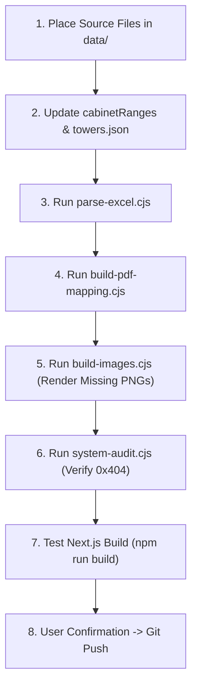

# INTEQC Drawing & Electrical Schematic Onboarding SOP

This skill defines the complete Standard Operating Procedure for onboarding new Towers, Cabinets, and Electrical Schematics into the **INTEQC I/O Finder** system.

---

## 1. System Philosophy & Architecture Rules

### 1.1 Dual Schematic Structure
Industrial electrical drawing packages contain two distinct types of sheets:
1. **PLC I/O Sheets (24V DC)**: Contain 24V DI/DO wiring, field sensor terminals, relay coils, and PLC bit addresses (e.g., `I0.0`, `Q12.4`). These map directly to PLC tag spreadsheets.
2. **Electrical Power & Control Schematics (380V / 220V)**: Contain 3-phase power distribution, circuit breakers, contactors, thermal overloads, soft starters, VFD frequency inverters, power meters, control interlocks, and valve manifolds. **These do NOT contain PLC bit addresses**, but are critical for electricians troubleshooting machines.

The system must map **both** sheet types to machine equipment codes so technicians have instant access to power circuits, starter schematics, and PLC wiring from a single view.

### 1.2 Mandatory Project Constraints
- **English-Only UI**: All equipment names, category labels, badges, and user-facing text must be displayed in **English only**. Chinese text from drawing title blocks must be translated or mapped to English categories before reaching the UI.
- **Extensible Architecture**: New Towers and Cabinets must be easily addable via declarative configuration (`data/towers.json` and `cabinetRanges` in `build-pdf-mapping.cjs`) without rewriting core viewer logic.
- **Zero Broken Links (0 × 404)**: Every schematic pill and drawing dropdown item rendered in the UI must correspond to a verified physical PNG image on disk.
- **Git Push Protection**: **Always obtain explicit user confirmation** before running `git push` to GitHub remotes (`origin` and `backup`).

---

## 2. Source Data Organization

Source files are stored per-location under the `data/` directory:

```text
data/
├── Tower 1/
│   ├── 泰国inteqc Cabinet drawing.pdf
│   └── PLCTags.xlsx
├── Tower 2/
│   ├── Phase 1/
│   │   ├── 泰国inteqc Cabinet drawing.pdf
│   │   └── PLCTags.xlsx
│   └── Phase 2/
│       ├── 泰国inteqc Cabinet drawing.pdf
│       └── PLCTags.xlsx
└── Tower 3/
    ├── 泰国inteqc Cabinet drawing.pdf
    └── PLCTags.xlsx
```

### Location IDs
- `tower1`: Tower 1
- `tower2_p1`: Tower 2 (Phase 1)
- `tower2_p2`: Tower 2 (Phase 2)
- `tower3`: Tower 3
- Future towers should follow the lowercase naming pattern: `tower4`, `tower5`, etc.

---

## 3. Physical Drawing Structure & Reading Heuristics

### 3.1 Internal Page Number (页数) vs. PDF Page Index
> [!IMPORTANT]
> The PDF viewer page index (1-based physical page in Adobe/PDF reader) does **NOT** equal the drawing sheet's internal page number (`页数`).
> Image files on disk are named by internal page: `<Cabinet>_page_<InternalPageNumber>.png` (e.g., `RCB7_page_173.png`, `CB_page_2.png`).

### 3.2 Reading the Table of Contents (目录)
Most drawings begin with 目录 (Index) pages containing 6 structured columns:
| Column | Header | Description |
|---|---|---|
| 1 | Location | Cabinet ID (e.g., `LCB_6B`, `MCC14`, `RCB7`) |
| 2 | Page | Internal page number (e.g., `173`, `2503`) |
| 3 | Title (CN) | Chinese title / machine description |
| 4 | Title (EN) | English title / description |
| 5 | 日期 (Date) | Creation or revision date |
| 6 | 编辑者 (Editor) | Engineer initials |

### 3.3 Title Block Parsing Patterns

#### A. Chinese Title Blocks (e.g., Tower 2 Phase 1 & Phase 2)
Located in the bottom-right corner of each sheet:
- **True Page Number Extraction (Date-Follower Pattern)**:
  > [!CRITICAL]
  > In EPLAN CAD drawings for Tower 2, the bottom-left margin displays the **previous sheet's cross-reference number** (e.g. `172`, `2110`).
  > In the raw PDF text stream, this margin number appears directly before `魏正彪 审核`. Matching before `魏正彪 审核` creates a systematic **off-by-one (-1) error across all sheets**!
  > Instead, the **true sheet number** is positioned in the `页号 Page` cell immediately following the creation date (`YYYY/M/D` pattern).
  > **Mandatory pattern**: Scan lines for `/^\d{4}\/\d{1,2}\/\d{1,2}$/` and extract the token directly on the next line (e.g. `173`, `174`, `2111`).
  > For cover/overview sheets without a date, use the `格式 A4\s+([0-9a-zA-Z\.\-_]+)` pattern.

- Equipment code is typically followed by the circuit description, for example:
  - `G0104_3 软启动回路图` $\rightarrow$ Equipment: `G0104_3`, Type: Soft Starter Circuit
  - `G0203_3 变频器回路图` $\rightarrow$ Equipment: `G0203_3`, Type: VFD Drive Circuit
  - `1001-2 控制回路` $\rightarrow$ Equipment: `1001-2`, Type: PLC Control Circuit
  - `气动阀 10.02.V` $\rightarrow$ Sub-tag: `10.02.V`, Parent: `10.02`

#### B. English Title Blocks (e.g., Tower 3 Muyang-WEM Format)
Text runs in the bottom border or title line:
- Format pattern: `PAGE TOTAL <TotalPages> ... <DrawingCode> ... 4 <InternalPage> 2`
- Or explicit Chinese page token: `页数 <InternalPage>` (excluding `总页数`)
- Equipment markers: `TOWARDS THE SILO FEEDING G0104_3`, `4_10.V`, `MCC14-01-M1`
- Noise to filter out: Electrical ratings (`5.5KW`, `6.9A`, `380V`, `24VDC`, wire gauges).

---

## 4. Standard 6-Category Schematic Classification

Every identified electrical schematic sheet must be mapped to one of the following standard English categories:

| Category Name | Badge Color | Matching Keywords (CN / EN) | Description |
|---|---|---|---|
| **Power & Metering** | Amber (`#f59e0b`) | `电源回路`, `电表`, `Power`, `Supply`, `Metering`, `Incoming` | 3-phase 380V incoming feeder, metering CTs, busbar distribution |
| **Soft Starter Circuit** | Violet (`#8b5cf6`) | `软起`, `Soft Starter`, `Soft start`, `SST` | Soft starter motor control, bypass contactor, fault feedback |
| **VFD Drive Circuit** | Blue (`#3b82f6`) | `变频器`, `Inverter`, `VFD`, `Frequency` | Frequency drive controller, analog speed reference, run/stop relays |
| **PLC Control Circuit** | Green (`#10b981`) | `控制回路`, `Control Circuit`, `PLC Control`, `Relay` | 24V/220V control interlocking, auxiliary contacts, run permissive |
| **Safety & Interlock** | Rose (`#f43f5e`) | `急停`, `Safety`, `E-Stop`, `Interlock` | Emergency stop circuits, pull-cord switches, safety relays |
| **Valve & Actuator** | Teal (`#14b8a6`) | `气动阀`, `电磁阀`, `Valve`, `Solenoid`, `Pneumatic` | Solenoid manifolds, position switches, damper actuators |

---

## 5. End-to-End Onboarding Protocol (Step-by-Step)



### Step 1: Ingestion & Cabinet Registration
1. Save the new PDF to `data/<Tower Name>/泰国inteqc Cabinet drawing.pdf`.
2. Save the PLC Tag spreadsheet to `data/<Tower Name>/PLCTags.xlsx`.
3. Open the PDF TOC (or scan first 30 pages) to determine cabinet internal page ranges.
4. Add cabinet definitions to `cabinetRanges` in `build-pdf-mapping.cjs`:
   ```javascript
   tower3: [
     { cabinet: 'CB', start: 3000, end: 3099 },
     { cabinet: 'MCC1', start: 1, end: 3 },
     { cabinet: 'MCC14', start: 1, end: 25 },
     // ...
   ]
   ```
5. Register the tower in `data/towers.json` and in `src/app/page.js` if updating the landing page selector.

### Step 2: Parse PLC Tags
Extract all 24V DI/DO channels, addresses, descriptions, and equipment tags:
```bash
node parse-excel.cjs
```
- Generates base `io-data.json` with tagged machines and I/O channels.

### Step 3: Electrical Schematic Extraction & Classification
Run the PDF extraction pipeline to map power circuits, starters, VFDs, and control sheets:
```bash
node build-pdf-mapping.cjs
```
- Heuristics to ensure:
  1. Strip electrical rating tokens (`KW`, `A`, `V`, `HZ`) to avoid creating phantom machines (e.g., `5.5KW`).
  2. Associate sub-equipment/valve tags (e.g., `4_10.V`, `4_25_V`) with parent machines (`4_10`, `4_25`).
  3. Classify each page using `classifySchematicPage()` into one of the 6 standard English categories.
  4. Generate updated `pdf-page-map.json`, `io-data.json`, and `search-index.json`.

### Step 4: High-Resolution Image Rendering Pipeline
Render all identified schematic pages into PNG images:
```bash
node build-images.cjs
```
- Images are saved to: `io-finder/public/drawings/<locationId>/cabinets/images/<Cabinet>_page_<PageNumber>.png`.
- Check rendering output: ensure no failed pages or truncated files.

### Step 5: System Quality Audit (Pre-flight Checklist)
Run the automated system audit to verify zero defects:
```bash
node system-audit.cjs
```
**Acceptance Criteria**:
- [ ] **Missing Images (404)**: Exactly `0`.
- [ ] **Rating Junk Keys**: Exactly `0` (no keys ending in `KW`, `A`, `V`).
- [ ] **Chinese Characters in UI Titles**: Exactly `0` in user-facing fields.
- [ ] **Total Schematic Links**: Greater than `0` for all active towers.

### Step 6: Frontend Build & UI Verification
1. Verify Next.js production build:
   ```bash
   npm --prefix io-finder run build
   ```
2. Check the Machine Detail page (`/machine/[locationId]/[cabinet]/[equipmentCode]`):
   - Interactive Quick-Access Schematic Pills appear below the machine header card.
   - Pills display correct category colors and labels (e.g., `⚡ Sheet 173 (Power & Metering)`).
   - Clicking a pill instantly switches the embedded Drawing Viewer to that schematic sheet.
   - Drawing dropdown lists sheets with descriptive English labels.

### Step 7: Git Push Protocol
1. Stage modified source files, JSON datasets, and rendered PNG images:
   ```bash
   git add .gitignore build-*.cjs data/ io-finder/src/ io-finder/public/
   git commit -m "feat: onboard <Tower Name> with comprehensive electrical schematics"
   ```
2. **STOP AND ASK FOR CONFIRMATION**:
   - Request explicit user approval before running `git push`.
3. Once confirmed, push to both remotes:
   ```bash
   git push origin master
   git push backup master
   ```

---

## 6. Common Pitfalls & Troubleshooting

### Pitfall 1: React 19 Style Shorthand Conflict
- **Symptom**: Console error `Warning: Overriding style property 'border' with 'borderColor'`.
- **Fix**: In `page.js`, do not combine shorthand `border: '1px solid ...'` with individual `borderColor: ...`. Use explicit properties:
  ```javascript
  borderWidth: '1px',
  borderStyle: 'solid',
  borderColor: cat.border,
  ```

### Pitfall 2: Windows Word Temporary Lock Files
- **Symptom**: Git fails or reports untracked files like `~WRL3331.tmp` or `~$PLCTags.xlsx`.
- **Fix**: Ensure `.gitignore` includes:
  ```gitignore
  ~$*
  ~*.tmp
  *.tmp
  ```

### Pitfall 3: Sub-tag Machine Fragmentation
- **Symptom**: Technicians search for machine `4_10` but cannot find solenoid valve `4_10.V`.
- **Fix**: In `build-pdf-mapping.cjs`, implement sub-tag linkage:
  ```javascript
  const parentCode = token.replace(/[\._]V\d*$/i, '');
  if (machines[parentCode]) {
    // attach schematic sheet to parentCode as well
  }
  ```

### Pitfall 4: Electrical Ratings Classified as Machines
- **Symptom**: Search results show `5.5KW`, `6.9A`, `11KW` as equipment codes.
- **Fix**: Filter tokens against electrical rating regex:
  ```javascript
  if (/^\d+(\.\d+)?(KW|A|V|HZ|HP)$/i.test(token)) return null;
  ```

### Pitfall 5: Hyphen Truncation & Over-Mapping (Collapsed Machine Keys)
- **Symptom**: Equipment codes like `AG-3101` display false pills from unrelated machines (`AG-4001`, `AG-9001`, `AG-1101`), or `PU-1001` shows 27 pills, or `AV-1001` shows 63 pills.
- **Root Cause**: Title block regex `/^([A-Z0-9_]+)\s*[-–]/i` stops at the internal hyphen in `AG-3101-`, collapsing hundreds of distinct machines into bare alpha keys (`AG`, `PU`, `AV`).
- **Fix**:
  1. Match internal hyphens first in `extractEquipFromTitleLine`:
     ```javascript
     const m = s.match(/^([A-Z0-9_]+(?:-[A-Z0-9_]+)+)\s*[-–]?/i) || s.match(/^([A-Z0-9_]+)\s*[-–]/i);
     ```
  2. Guard `suffixCheck` in `page.js` to require digits in the base code (`/\d/.test(base)`), strictly forbidding pure-letter matching like `"AG"` $\rightarrow$ `"AG_3101"`.

### Pitfall 6: Cabinet Array Prefix Shadowing (MCCB1 vs MCCB10..19)
- **Symptom**: Pages belonging to `MCCB10`, `MCCB13`, `MCCB18`, `MCCB19` get assigned to `MCCB1`. Equipment with duplicate numbers across cabinets (e.g. `E0265` Sizing Screen in `MCCB13` vs `E0265` Cooler in `MCCB19`) leak schematics between different physical machines.
- **Fix**:
  1. Always sort `cabinetList` by length descending (`b.length - a.length`) before substring matching so `MCCB13` is tested before `MCCB1`.
  2. In `page.js`, isolate distinct MCC lineups by checking `extractMcc(s.cabinet) === extractMcc(cabinet)`.

### Pitfall 7: Shared WAGO Rack Cards & Body Cross-Reference Bleed
- **Symptom**: Technicians see 10+ pills for 16-channel WAGO DI/DO/AI rack cards or power distribution pages on individual machine views.
- **Root Cause**: Scanning all body lines (`Rule 4`) on shared rack pages and terminal tables pulls in every connected device label.
- **Fix**:
  1. Define `isSharedCardOrLayout` to skip `equipmentDrawings` for shared cards (`Wago DI/DO/AI`, `CPU1215`, `SM1223`, `远程站模块布局`, `电源分配`, `端子`).
  2. Only execute Rule 4 if `!isSharedCardOrLayout && foundEquips.size === 0` (preventing interlock cross-references like `5_117A` mentioned on fan `5_126` from attaching to the wrong machine).

### Pitfall 8: Synthetic Parent Sibling Cross-Contamination
- **Symptom**: Sub-units like `3.5A_1` show 10 pills including drawings belonging to siblings `3.5B`, `3.5C`, `3.5D`.
- **Root Cause**: Aggregating sub-units into a synthetic parent code `3.5` causes `suffixCheck` to bridge all sibling schematics together.
- **Fix**: Never synthesize parent codes during PDF and TOC parsing. Keep sub-units strictly keyed to their individual equipment codes (`3.5A_1`, `3.5B`).

### Pitfall 9: Delimiter Stripping Collisions (2.42 vs 24.2 / 7.3 vs 73)
- **Symptom**: Machine `7.3` matches `73`, or `2.42` matches `24.2`.
- **Root Cause**: Normalization removing all punctuation (`replace(/[\s_\-\.\,\/\\]/g, '')`) collapses decimal boundaries into the same string.
- **Fix**: Standardize `normalizeCode` across backend and frontend to convert delimiters to dot (`replace(/[\s_\-\/\\]+/g, '.')`), preserving decimal positions.

### Pitfall 10: TOC Index Pages Polluting Cabinet Range Detection
- **Symptom**: Image offsets break because `cabinetMinPage` is pulled down to pages 9–20.
- **Root Cause**: In Tower 2, TOC index pages have internal numbers like `1.a`, `1.c`, `1.e`.
- **Fix**: In `scanPdf()`, skip index pages:
  ```javascript
  if (loc.cabinetList && internalPageStr.includes('.')) return;
  ```

### Pitfall 11: Image Cache Invalidation on minPage Shift
- **Symptom**: Equipment like `AG-3101` in `MCC5-6` displays the schematic for `AG-4101` (off-by-one image mismatch), even though `pdf-page-map.json` and `io-data.json` have the correct sheet number.
- **Root Cause**:
  1. When PDF parsing heuristics are improved (e.g. adding the Date-Follower pattern), newly discovered boundary sheets (e.g. Sheet 401 on PDF Page 157) cause the cabinet's `minPage` to shift from 158 to 157.
  2. Because image filenames are generated as `<Cabinet>_page_<pdfPage - minPage + 1>.png`, Sheet 454 (PDF Page 201) changes from `page_44.png` to `page_45.png`.
  3. However, `build-images.cjs` previously skipped files already existing on disk (`if (fs.existsSync(destPath)) continue`). The file `MCC5-6_page_45.png` on disk had been generated months earlier when `page_45` corresponded to PDF Page 202 (`AG-4101`).
- **Fix**:
  1. Add CLI flags `--force`, `--location <id>`, and `--cabinet <name>` to `build-images.cjs`.
  2. When running `--force`, purge stale image files that exceed the current cabinet range.
  3. Whenever `build-pdf-mapping.cjs` alters `minPage` for any cabinet, ALWAYS run:
     ```bash
     node scripts/build-images.cjs --force --location <locationId>
     ```
  4. Followed by rebuilding the search index and data:
     ```bash
     node scripts/parse-excel.cjs
     ```

### Pitfall 12: Deterministic Cabinet Physical PDF Bounds (minPdf / maxPdf)
- **Symptom**: Accessories, junction boxes, or dimension specifications (e.g. `300*250*140` on PDF Page 778) falsely match sheet number patterns (matching `250` as sheet 250), causing trailing pages to be assigned to an earlier cabinet (e.g. `MCC1-2`).
- **Root Cause**: Relying solely on sheet number ranges (`start: 101, end: 299`) allows rogue numbers from late-stage physical pages to collide with early cabinets.
- **Fix**: Declare both internal sheet ranges AND physical PDF page bounds (`minPdf` / `maxPdf`) in `CAB_RANGES_P1` and `CAB_RANGES_P2`:
  ```javascript
  { cabinet: 'MCC1-2', start: 101, end: 299, minPdf: 8, maxPdf: 100 }
  ```
  In `scanPdf()`, strictly verify `pdfPage >= range.minPdf && pdfPage <= range.maxPdf` before assigning the page to that cabinet.


