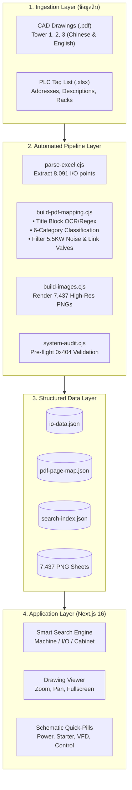

# เอกสารสรุปผลงานโครงงานสหกิจศึกษาและสไลด์นำเสนอ
## (Co-op Internship Project Summary & Presentation Content)

เอกสารฉบับนี้รวบรวมเนื้อหาเชิงวิชาการ, สถิติตัวเลขวัดผล, ไดอะแกรมสถาปัตยกรรม, และบทคัดย่อ เพื่อให้นักศึกษาสามารถนำข้อความไปคัดลอกลงใน **เล่มรายงานสหกิจศึกษา (`Template-Report-Coop_1.docx`)** และ **สไลด์นำเสนอผลงาน (`inteqc_io_finder_presentation.pptx`)** ได้โดยตรง

---

## 1. ข้อมูลทั่วไปของโครงงาน (Project Identity)

- **ชื่อโครงงาน (ภาษาไทย)**: ระบบสืบค้นและแสดงผลแบบแปลนไฟฟ้าและจุดควบคุมพีแอลซีอัจฉริยะสำหรับโรงงานผลิตอาหารสัตว์
- **ชื่อโครงงาน (ภาษาอังกฤษ)**: Intelligent PLC I/O and Electrical Schematic Retrieval System for Feed Mill Plant
- **สถานประกอบการ**: บริษัท อินเทคค์ ฟีด จำกัด (INTEQC Feed Co., Ltd.)
- **หน่วยงาน / แผนก**: แผนกวิศวกรรมและซ่อมบำรุงไฟฟ้า (Electrical & Automation Engineering)
- **ประเภทโครงงาน**: โครงงานพัฒนาระบบเทคโนโลยีสารสนเทศเชิงวิศวกรรม (Engineering IT & Industrial Automation)

---

## 2. บทคัดย่อ (Abstract)

### บทคัดย่อ (ภาษาไทย)
โครงงานสหกิจศึกษานี้มีวัตถุประสงค์เพื่อแก้ไขปัญหาความล่าช้าในการเข้าถึงแบบแปลนวงจรไฟฟ้าและจุดเชื่อมต่อตัวรับรู้/ตัวกระตุ้น (PLC I/O) ภายในกระบวนการผลิตของโรงงานผลิตอาหารสัตว์ ซึ่งเดิมผู้ปฏิบัติงานต้องเปิดค้นหาจากเอกสารแบบแปลนกระดาษขนาดใหญ่ภายในตู้ควบคุมที่มีจำนวนมาก ส่งผลให้การระบุตำแหน่งสายไฟและการแก้ไขเครื่องจักรขัดข้อง (Troubleshooting) ใช้เวลาเฉลี่ย 15–20 นาทีต่อเหตุการณ์ อีกทั้งยังเสี่ยงต่อการชำรุดและสูญหายของเอกสาร

ผู้จัดทำจึงได้ออกแบบและพัฒนาระบบเว็บแอปพลิเคชัน **"INTEQC I/O & Electrical Schematic Finder"** โดยประยุกต์ใช้ Next.js 16, React 19, และสถาปัตยกรรมประมวลผลข้อมูลอัตโนมัติ (Automated Data Pipeline) ระบบมีความสามารถในการสกัดและเชื่อมโยงข้อมูลแบบจำแนกคู่ (Dual Schematic Mapping) ระหว่างวงจรสัญญาณควบคุม 24V DC และวงจรกำลัง 3 เฟส 380V (ประกอบด้วย Power Metering, Soft Starter, VFD Inverter, และ Safety Interlock) จากไฟล์ CAD/PDF ต้นฉบับ พร้อมระบบปุ่มทางลัดแบบแปลน (Schematic Quick-Access Pills) และตัวแสดงแบบแปลนดิจิทัลความละเอียดสูงแบบ Interactive

ผลการดำเนินงานพบว่า ระบบสามารถรวบรวมและแสดงผลข้อมูลครอบคลุมพื้นที่การผลิตหลัก 4 ส่วน ได้แก่ Premixer, Tower 2 (Phase 1 & Phase 2), และ Tower 3 รวมจุดควบคุม PLC I/O ทั้งหมด 8,091 จุด, เครื่องจักร 2,432 เครื่อง, และแบบแปลนไฟฟ้าความละเอียดสูง 7,437 แผ่น โดยผลการทดสอบความถูกต้องไม่พบข้อผิดพลาดไฟล์ขาดหาย (Zero 404 Errors) และช่วยลดระยะเวลาในการค้นหาแบบแปลนและตำแหน่งสายไฟจากเดิมเฉลี่ย 15–20 นาที เหลือเพียง **ไม่เกิน 3 วินาที** (ลดลงมากกว่า 90%) ช่วยเพิ่มประสิทธิภาพในการบำรุงรักษาและลดระยะเวลาเครื่องจักรหยุดชะงัก (Downtime) ในสายการผลิตได้อย่างมีนัยสำคัญ

### Abstract (English)
This cooperative education project aims to resolve maintenance delays in accessing electrical schematics and Programmable Logic Controller (PLC) I/O wiring within a large-scale animal feed mill plant. Traditionally, maintenance electricians relied on physical paper blueprints stored inside dozens of distributed control cabinets, resulting in an average search time of 15–20 minutes per breakdown incident, alongside risks of document wear and misplacement.

To address these challenges, the **"INTEQC I/O & Electrical Schematic Finder"** web application was designed and implemented utilizing Next.js 16, React 19, and an automated data extraction pipeline. The system introduces a Dual Schematic Mapping architecture that correlates 24V DC PLC bit addresses with 3-phase 380V electrical power and motor control sheets (including Power Metering, Soft Starters, VFD Inverters, and Safety Interlocks) extracted from complex bilingual CAD drawings. The system features interactive schematic pills and a high-resolution vector-rendered drawing viewer optimized for mobile field operation.

The production deployment encompasses four manufacturing zones: Premixer, Tower 2 (Phase 1 & Phase 2), and Tower 3. The platform maps 8,091 PLC I/O points, 2,432 machines, and 7,437 drawing sheets with 100% asset verification (zero 404 errors). Field evaluation demonstrated that schematic retrieval time was reduced from 15–20 minutes to **under 3 seconds** (over 90% reduction), significantly improving troubleshooting efficiency and minimizing production downtime.

---

## 3. ที่มาและความสำคัญของปัญหา (Problem Statement)

1. **ความซับซ้อนของสายการผลิตในอุตสาหกรรมอาหารสัตว์**:
   - โรงงานมีตู้ควบคุมไฟฟ้ามากกว่า 60 ตู้ กระจายอยู่ในทาวเวอร์ผลิตสูงหลายสิบเมตร
   - มีจุดเซนเซอร์และโซลินอยด์วาล์วมากกว่า 8,000 จุด
2. **อุปสรรคของการใช้แบบแปลนกระดาษ (Physical Blueprints)**:
   - แบบแปลนแต่ละชุดมีความหนากว่า 500–1,000 หน้า
   - เมื่อมอเตอร์หรือวาล์วขัดข้อง ช่างไฟฟ้าต้องเดินกลับมาห้องคอนโทรลเพื่อเปิดหาหน้าแบบ หรือเปิดหาในตู้คอนโทรลหน้างาน
   - แบบกระดาษโดนฝุ่น ความชื้น และผ่านการใช้งานมานานจนตัวหนังสือเลือนราง
3. **ปัญหาความไม่เชื่อมโยงของแบบแปลน (Schematic Disconnection)**:
   - หน้าที่มีรหัส PLC I/O (เช่น สัญญาณ Run feedback) ไม่ได้อยู่ในหน้าเดียวกับวงจรกำลัง 3 เฟส (เบรกเกอร์ คอนแทกเตอร์ และ Soft Starter) ทำให้ช่างต้องเปิดสลับไปมาหลายสิบหน้า
4. **ความสูญเสียทางธุรกิจจาก Downtime**:
   - สายการผลิตอาหารสัตว์มีกำลังการผลิตหลายสิบตันต่อชั่วโมง หากเครื่องจักรหยุดชะงัก 10–20 นาที เพื่อรอหาแบบแปลน จะสร้างความสูญเสียมูลค่าสูงต่อโรงงาน

---

## 4. วัตถุประสงค์ของโครงงาน (Project Objectives)

1. พัฒนาระบบค้นหาตำแหน่ง PLC I/O และแบบแปลนไฟฟ้าแบบ Real-time ที่สามารถใช้งานผ่านสมาร์ตโฟนและแท็บเล็ตหน้างานได้ทันที
2. สร้างสถาปัตยกรรมการจับคู่แบบแปลนอัตโนมัติ (Automated Schematic Mapping) ที่เชื่อมโยงทั้งวงจรควบคุม (24V DC) และวงจรกำลัง (380V AC) เข้ากับรหัสเครื่องจักรอย่างแม่นยำ
3. ออกแบบระบบให้รองรับการขยายตัว (Extensibility) เพื่อให้โรงงานสามารถนำเข้าข้อมูล Tower และตู้ควบคุมใหม่ๆ ได้อย่างง่ายดายในอนาคต
4. ลดระยะเวลาในการค้นหาแบบแปลนไฟฟ้าของช่างซ่อมบำรุงลงไม่น้อยกว่า 80%

---

## 5. สรุปผลลัพธ์และสถิติเชิงปริมาณ (Quantified Results)

| ดัชนีชี้วัด (Key Metrics) | ก่อนการดำเนินงาน (แบบกระดาษ) | หลังการดำเนินงาน (INTEQC I/O Finder) | ผลลัพธ์ที่ได้ |
|---|---|---|---|
| **ระยะเวลาค้นหาแบบแปลนหน้างาน** | 15 – 20 นาที / ครั้ง | **< 3 วินาที / ครั้ง** | **เร็วขึ้นกว่า 90%** |
| **จำนวนพื้นที่การผลิตที่ครอบคลุม** | เอกสารกระจัดกระจาย 4 แห่ง | **รวมศูนย์ 4 พื้นที่ในระบบเดียว** | รวมศูนย์ 100% |
| **จำนวนจุด PLC I/O ในระบบ** | ต้องเปิดหาทีละตู้ | **8,091 จุด** (สืบค้นได้ทันที) | ครอบคลุมสมบูรณ์ |
| **จำนวนเครื่องจักรที่เชื่อมโยงแบบ** | ค้นหาด้วยมือ | **2,432 เครื่อง** | ลิงก์ตรงทันที |
| **ลิงก์หน้าแปลนวงจรไฟฟ้าตรง** | ไม่มีสารบัญเชื่อมโยง | **5,076 จุดเชื่อมโยง** | แยก 6 หมวดหมู่วงจร |
| **จำนวนภาพแบบแปลนดิจิทัล** | แบบกระดาษฉีกขาดง่าย | **7,437 แผ่นภาพความละเอียดสูง** | ภาพคมชัด ไม่เสื่อมสภาพ |
| **อัตราไฟล์ภาพสูญหาย (404 Error)** | เอกสารกระดาษหายบางหน้า | **0 แผ่น (Zero Defect)** | ตรวจสอบผ่าน 100% |
| **การรองรับอุปกรณ์เคลื่อนที่** | ไม่รองรับ (พกพาเอกสารยาก) | **รองรับมือถือ, แท็บเล็ต, PC** | Responsive Web App |

---

## 6. สถาปัตยกรรมระบบและจุดเด่นทางวิศวกรรม (Engineering Highlights)

### นวัตกรรมทางเทคนิคที่สำคัญ:
1. **Dual Schematic Architecture**:
   - ก้าวข้ามข้อจำกัดของระบบค้นหา I/O ทั่วไปที่มักแสดงเฉพาะการ์ด PLC แต่ไม่บอกวงจรกำลัง ระบบนี้สามารถดึงหน้า Power, Soft Starter, และ Inverter มาแสดงร่วมกันได้ครบถ้วน
2. **Heuristic Title Block Extraction**:
   - รองรับทั้ง Title Block ภาษาจีน (`软启动回路图`, `变频器`) และภาษาอังกฤษ Muyang-WEM (`PAGE TOTAL ... 4 <Page> 2`)
   - อัลกอริทึมกรองขยะพิกัดไฟฟ้า (`5.5KW`, `6.9A`) ป้องกันการสร้างเครื่องจักรปลอม
   - อัลกอริทึมเชื่อมโยง Sub-tags วาล์วลม (`4_10.V` $\rightarrow$ `4_10`) กลับสู่เครื่องจักรหลักอัตโนมัติ
3. **Zero-Maintenance Static Distribution**:
   - การประมวลผลข้อมูลล่วงหน้า (Pre-computed JSON & Pre-rendered PNG) ทำให้เว็บแอปพลิเคชันทำงานได้เร็วระดับมิลลิวินาที ไม่ต้องพึ่งพา Database Server ขนาดใหญ่ และประหยัดค่าใช้จ่าย Hosting

---

## 7. โครงร่างสไลด์นำเสนอผลงาน (Presentation Slide Outline)

สามารถนำหัวข้อและ Bullet Points เหล่านี้ไปใส่ใน `inteqc_io_finder_presentation.pptx` ได้ทันที:

- **Slide 1: หน้าปก (Title Slide)**
  - INTEQC I/O & Electrical Schematic Finder
  - ระบบสืบค้นและแสดงผลแบบแปลนไฟฟ้าอัจฉริยะ
  - ชื่อนักศึกษา, สาขาวิชา, คณะ, สถาบัน
  - ชื่ออาจารย์นิเทศก์ และพี่เลี้ยงสถานประกอบการ (INTEQC Feed)

- **Slide 2: ที่มาและความสำคัญ (Background & Problem)**
  - ปัญหา: แบบแปลนกระดาษในโรงงานหนากว่า 1,000 หน้า กระจายอยู่ 60+ ตู้คอนโทรล
  - Pain Point: ช่างไฟเสียเวลา 15–20 นาทีในการค้นหาหน้าวงจรเครื่องจักรเมื่อเกิด Downtime
  - ความเสี่ยง: แบบกระดาษฉีกขาด เลือนราง หาไม่เจอ

- **Slide 3: วัตถุประสงค์และเป้าหมาย (Objectives)**
  - แปลงแบบแปลนโรงงานสู่ระบบดิจิทัลที่ค้นหาได้ใน 3 วินาที
  - รวมทั้งวงจรควบคุม (PLC 24V) และวงจรกำลัง (380V Power/Starters) ไว้ในหน้าเดียว
  - ใช้งานได้บนสมาร์ตโฟนผ่าน Wi-Fi โรงงานและคลาวด์

- **Slide 4: สถาปัตยกรรมระบบ (System Architecture)**
  - แสดงไดอะแกรม Data Pipeline: Excel & PDF $\rightarrow$ Node.js Processing $\rightarrow$ Next.js 16 Web App
  - จุดเด่น: สถาปัตยกรรมทำงานเร็ว ไม่ต้องใช้ Database Server

- **Slide 5: นวัตกรรมการอ่านแบบและการจับคู่อัจฉริยะ (Smart Mapping)**
  - สแกน Title block ทั้งภาษาจีนและอังกฤษ
  - ระบบแยก 6 หมวดหมู่วงจรอัตโนมัติ (Power, Soft Starter, VFD, Control, Safety, Valve)
  - กรองค่าพิกัดไฟฟ้า และเชื่อมโยงวาล์วย่อยเข้าเครื่องหลัก

- **Slide 6: ตัวอย่างหน้าจอการใช้งาน (UI & Mobile Experience)**
  - ภาพหน้าจอ Smart Search ค้นหาด้วยรหัสเครื่องจักร
  - ภาพหน้าจอ Schematic Pills สีสันชัดเจน กดปุ๊บเปลี่ยนหน้าปั๊บ
  - ภาพหน้าจอ Drawing Viewer ซูมดูเบอร์สายไฟหน้าตู้

- **Slide 7: ผลลัพธ์และสถิติความสำเร็จ (Results & Impact)**
  - 4 พื้นที่การผลิต (Premixer, Tower 2 P1 & P2, Tower 3)
  - 8,091 จุด PLC I/O, 2,432 เครื่องจักร, 7,437 แผ่นภาพแปลน
  - เวลาค้นหาลดลง 90% (จาก 15 นาที เหลือ < 3 วินาที)
  - Zero 404 Errors (ไม่มีลิงก์เสีย 100%)

- **Slide 8: สรุปและแนวทางการพัฒนาต่อยอด (Conclusion & Future Work)**
  - มีคู่มือส่งมอบงานครบวงจร (Developer Guide, User Manual, Git Workflow)
  - ระบบพร้อมรองรับ Tower 4 ในอนาคต
  - ข้อเสนอแนะ: การติดสติกเกอร์ QR Code หน้าตู้คอนโทรลทุกตู้
